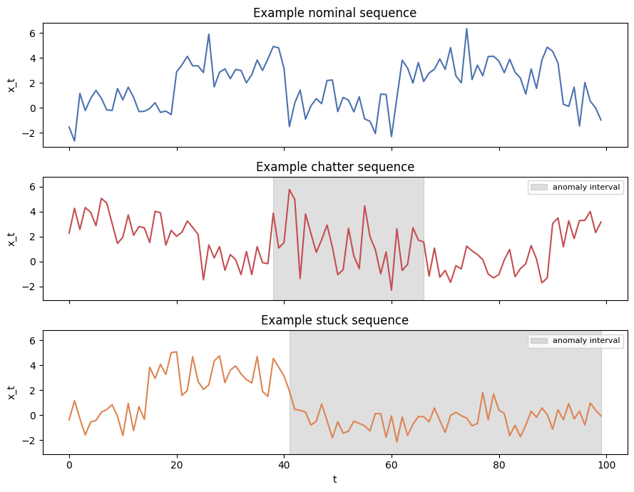
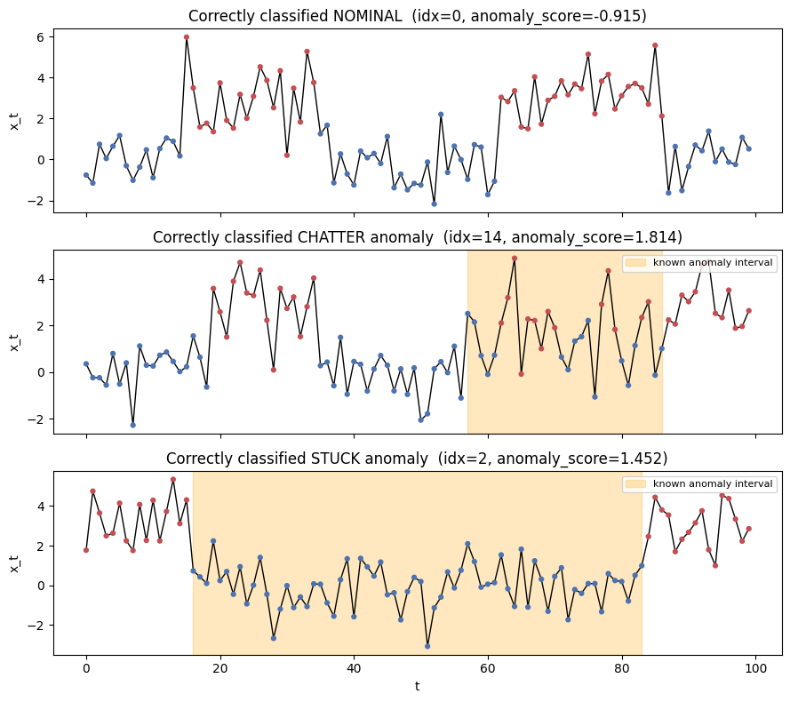
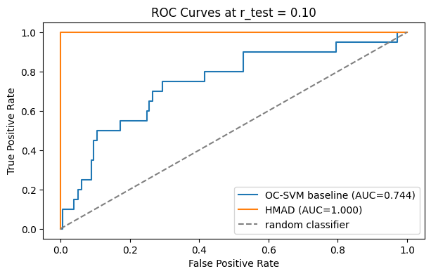

# Hidden Markov Anomaly Detection: OC-SVM vs. Sequence-Aware Models

**Can a detector recognize anomalous behavior when individual observations still look normal?**

This project compares a conventional **One-Class Support Vector Machine (OC-SVM)** with a **simplified Hidden Markov Anomaly Detection (HMAD)** pipeline. The experiments isolate *temporal structure*: anomalous sequences retain the same observation distributions as normal sequences, but change how frequently the underlying system switches between states.

On the main synthetic test set, the sequence-aware approach achieves **0.9988 ROC-AUC**, compared with **0.7963** for the flattened-feature OC-SVM baseline. Removing Viterbi state inference reduces HMAD's ROC-AUC to **0.5000**, highlighting the importance of modeling transitions.

> **Context:** Introduction to Machine Learning course project, Sharif University of Technology (Spring 1405 / 2026). This is a controlled **synthetic-data study**, not a benchmark on real operational logs. The HMAD implementation is a simplified, HMM-assisted one-class detector rather than a reproduction of every aspect of the original HMAD formulation.

## Overview

Many anomaly detectors operate on individual measurements or fixed-dimensional representations of a time series. They may miss anomalies characterized primarily by **unusual event ordering, switching rates, or state dwell times**.

We study two types of temporal anomalies:

- **Chatter:** the system switches between operating states unusually rapidly.
- **Stuck:** the system stays in one operating state far longer than usual.

The underlying values are still sampled from the same state-dependent Gaussian distributions. As a result, the main distinguishing information is in the **sequence of transitions**, although aggregate statistics can retain some indirect signal, particularly for stuck anomalies.



## Synthetic dataset

We generate independent, fixed-length sequences from a two-state **semi-Markov regime-switching process**:

| Property | Configuration |
| --- | --- |
| Sequence length | 100 observations |
| State 0 (Low) | Gaussian, $\mathcal{N}(0,1)$ |
| State 1 (High) | Gaussian, $\mathcal{N}(3,1)$ |
| Normal state dwell time | 15–30 steps |
| Chatter anomaly | Dwell times of 1–3 steps within a randomly placed window |
| Stuck anomaly | Abnormally long dwell of 55–75 steps |
| Training set | 200 nominal sequences (20,000 time steps) |
| Main held-out test set | 150 nominal + 50 anomalous sequences |
| Random seed | `1405` |

Importantly, **the generator is semi-Markov** because it samples dwell times explicitly. The fitted first-order Gaussian HMM is used as an *approximation* of those dynamics, not as a claim about the exact data-generating process.

No external dataset or download is required; the notebook generates all experiment data locally.

## Methods

### 1. OC-SVM baselines

We train an RBF-kernel `OneClassSVM` on nominal sequences only (`nu=0.1`, `gamma="scale"`), with `StandardScaler` fit exclusively on training data. Three fixed-vector feature representations are compared:

- **Global statistics:** mean, standard deviation, minimum, maximum, and median.
- **Flattened sequence:** all 100 observations in temporal order.
- **Window statistics:** mean and standard deviation in each of 10 consecutive windows.

The flattened representation is used as the **pre-specified baseline** for the subsequent HMAD comparison. The representation comparison on the test set is descriptive, not a model-selection procedure.

### 2. Simplified HMAD pipeline

The sequence-aware method combines a two-state Gaussian HMM with one-class classification:

1. **Initialize** the HMM's emission parameters with K-means and a persistent initial transition matrix.
2. **Decode latent states** using log-space Viterbi decoding.
3. **Update HMM parameters** from decoded paths and construct a joint sequence representation.
4. **Fit an OC-SVM** to those joint features, repeating the decoding-and-refitting loop until assignments stabilize.
5. **Score new sequences** by Viterbi decoding, feature extraction, scaling, and the negative OC-SVM decision score.

For two latent states, the joint representation contains **six features**: four normalized state-transition counts and two state-conditioned mean observations. This explicitly exposes the switching patterns that conventional summary features do not model.

The notebook also includes numerical demonstrations of HMM sequence generation, log-space probability calculations, and Viterbi decoding.

## Results

### Main comparison

| Method | ROC-AUC |
| --- | ---: |
| OC-SVM — window features | 0.6873 |
| OC-SVM — global summary features | 0.7208 |
| **OC-SVM — flattened features (baseline)** | **0.7963** |
| **Simplified HMAD (with Viterbi)** | **0.9988** |
| HMAD with fixed latent states (without Viterbi) | 0.5000 |

The simplified HMAD model substantially improves detection of switching-pattern anomalies on this deliberately structured dataset. The Viterbi ablation is especially informative: removing inferred state transitions reduces performance to chance level.



### Threshold-based performance

On the main test set, with anomalies labeled as the positive class and the default OC-SVM decision boundary:

| Method | Precision | Recall | F1 score |
| --- | ---: | ---: | ---: |
| OC-SVM (flattened baseline) | 0.363 | 0.820 | 0.503 |
| Simplified HMAD | 0.704 | 1.000 | 0.826 |

### Sensitivity to test contamination

For each contamination level, we keep **20 anomalous test sequences** and change the number of nominal test sequences:

| Anomaly fraction | OC-SVM ROC-AUC | HMAD ROC-AUC |
| --- | ---: | ---: |
| 1% | 0.8049 | 0.9860 |
| 5% | 0.7804 | 0.9957 |
| 10% | 0.7444 | 1.0000 |
| 20% | 0.7737 | 0.9981 |



All values above are taken from the report and were reproduced by running the supplied notebook from start to finish. Performance should not be interpreted as an estimate of accuracy on real-world anomaly datasets.

## Getting started

**Prerequisite:** Python 3.10+ and an environment where Jupyter Notebook can run.

```bash
# 1. Clone this repository, then enter its directory.
git clone <your-repository-url>
cd <your-repository-directory>

# 2. Create and activate an isolated environment.
python -m venv .venv
source .venv/bin/activate   # macOS / Linux
# Windows PowerShell, instead: .\.venv\Scripts\Activate.ps1

# 3. Install dependencies.
python -m pip install -r requirements.txt

# 4. Open the notebook.
jupyter notebook notebookproject.ipynb
```

In Jupyter, select **Kernel → Restart Kernel and Run All Cells** (or the equivalent command in your Jupyter version). Run cells **in order**, because subsequent experiments reuse generated data, fitted models, and random-number-generator state from earlier cells.

The notebook generates plots inline and does not require a GPU, external datasets, or model checkpoints. Small numerical differences may occur with different dependency versions.

## Repository contents

```text
.
├── README.md
├── requirements.txt
├── notebookproject.ipynb     # All experiments and visualizations
├── report_project.pdf       # Full project report and theoretical discussion
└── figures/
    ├── sequence_examples.png
    ├── viterbi_decoding.png
    └── roc_comparison.png
```

For a complete mathematical discussion, implementation details, and additional experiments, see the [project report](report_project.pdf) and the [Jupyter notebook](notebookproject.ipynb).

## Limitations and takeaways

- The experiment is intentionally constructed so that temporal dependencies are central; **near-perfect synthetic-data results do not establish general-purpose anomaly detection performance**.
- Basic statistics are not entirely uninformative: stuck events can also change global variance indirectly.
- The simplified HMAD loop alternates state decoding, HMM parameter updates, and OC-SVM fitting; it does **not** implement full joint optimization of the theoretical latent structural OC-SVM objective.
- These experiments illustrate why **state inference and transition-aware representations** can matter more than raw measurement magnitudes for sequential anomalies.

## Project contributors

Mahyar Mohammadalipoor · Darya Azaddel · Ali Rezaei

*Introduction to Machine Learning — Sharif University of Technology, Spring 1405.*
